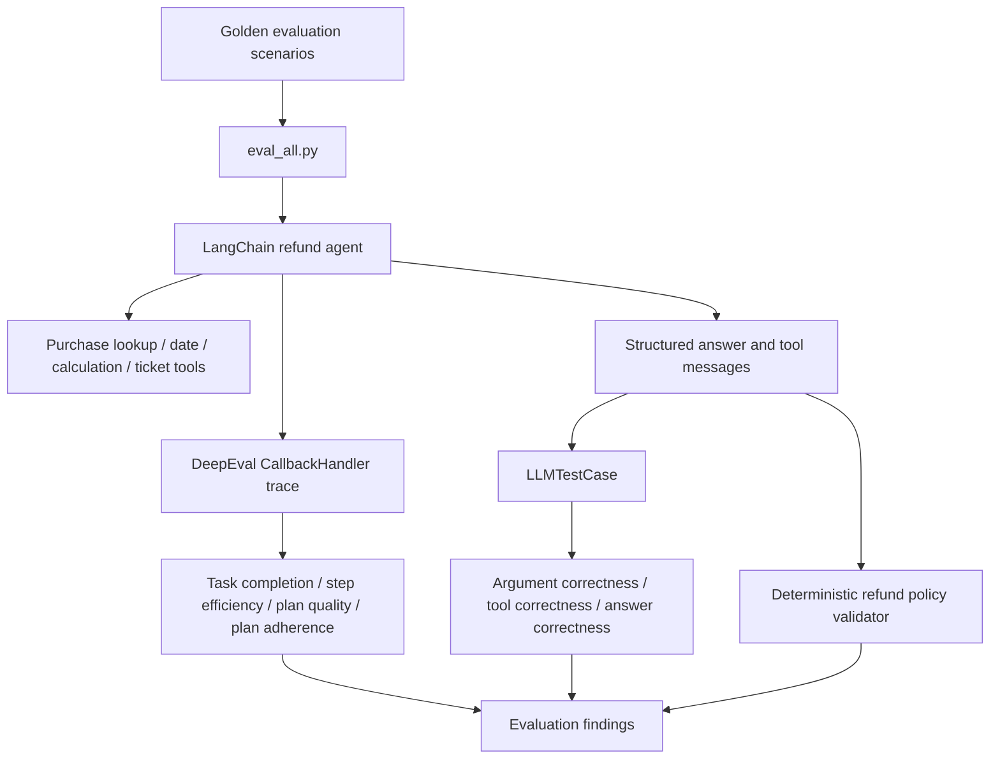

# Developing_LangChain_Agent_Evaluation_SystemProject maintained by Syed Tariq Ali · LinkedIn
Project overview
Evaluating an AI agent requires more than checking whether its final answer sounds plausible. An agent can call the expected tools and issue the correct refund amount without adequately establishing that the purchase is eligible. This project explores that gap by combining LLM-as-judge metrics with rule-based verification of the underlying business decision.
The demonstration system uses a customer-service refund agent. It retrieves purchase histories, checks dates against a 30-day refund window, calculates amounts, and issues simulated refund tickets. It does not initiate real payments.
What this implementation adds
- A combined evaluation workflow that runs the agent once per test case and reuses its execution for multiple metrics.
- Seven DeepEval metrics spanning task completion, planning, efficiency, tools, arguments, and answer quality.
- A separate refund_policy_validator.py for deterministic verification of eligible purchases, amounts, and tool-order prerequisites.
- Diagnostic output that keeps evaluation quality distinct from business-policy compliance.
- Reproducibility safeguards, including isolated conversation thread IDs and optional disabling of DeepEval caching.
Architecture

Evaluation framework
Evaluation	Implementation	Central question
Task Completion	TaskCompletionMetric	Did the agent complete the request under the stated rules?
Step Efficiency	StepEfficiencyMetric	Were tool calls and steps efficient?
Plan Quality	PlanQualityMetric	Was the proposed approach appropriate?
Plan Adherence	PlanAdherenceMetric	Did the execution follow the plan?
Argument Correctness	ArgumentCorrectnessMetric	Were tool input arguments appropriate?
Tool Correctness	ToolCorrectnessMetric	Were the expected tools selected?
Answer Correctness	GEval	Did the answer agree with the expected outcome?
Refund Policy Compliance	validate_refund_trace()	Was the refund objectively justified and correctly issued?

Refund Policy Compliance is an additional deterministic check, not an eighth DeepEval metric. Its score is reported separately rather than averaged with LLM-based judgments.
Refund-policy rules
For requests involving an identified customer, the validator uses the trace to assess whether:
1. Requested items were present in the customer's purchase history.
2. Purchase dates were valid and between 0 and 30 days old, inclusive, relative to the date returned by the date tool.
3. Only the requested, eligible items were included in the refund amount.
4. Required tool results were available before a refund ticket was issued.
5. The ticket amount matched the independently calculated eligible amount.
6. The tool response actually confirmed ticket creation.
Important distinction: Inferring eligibility independently from tool outputs does not prove that the language model explicitly reasoned through the date calculation. The validator supports an optional require_explicit_check setting for workflows with a dedicated eligibility-check tool. For stronger production controls, eligibility should also be enforced inside the ticket-issuing service.
Repository structure
Developing_LangChain_Agent_Evaluation_System/
├── agent/
│   ├── agent.py               # Agent orchestration
│   ├── tools.py               # Refund-related tools (if present in your branch)
│   ├── prompts.py             # Agent instructions (if present)
│   └── data.py                # Sample purchase data (if present)
├── evaluations/
│   ├── dataset.py             # Golden test cases
│   ├── model.py               # Evaluation model configuration
│   ├── eval_all.py            # Combined evaluation runner
│   ├── refund_policy_validator.py
│   ├── task_completion.py
│   ├── step_efficiency.py
│   ├── plan_quality.py
│   ├── plan_adherence.py
│   ├── tool_correctness.py
│   ├── argument_correctness.py
│   └── answer_correctness.py
├── .env.example               # Safe example configuration, if maintained
├── .gitignore
├── pyproject.toml
└── README.md
Some filenames in older examples differ (evaluate_all.py versus eval_all.py, and answer_correct.py versus answer_correctness.py). Use the filenames actually present in your checkout.
Getting started on Windows
1. Clone the repository
 git clone https://github.com/Alishaw99/Developing_LangChain_Agent_Evaluation_System.git
 cd Developing_LangChain_Agent_Evaluation_System
If the repository uses a different GitHub name, replace the URL with the repository's actual clone URL. If you are already working in your local D:\Developing_LangChain_Agent_Evaluation_System directory, you do not need to clone it again.
2. Set up the Python environment
The original project metadata required Python 3.13 or later. Check your current pyproject.toml before choosing an interpreter.
uv python install 3.13
uv venv --python 3.13
.venv\Scripts\activate
uv sync
Check your interpreter:
python --version
where python
3. Configure environment variables
Create a root-level .env file, for example:
OPENAI_API_KEY=your_key_here
Do not commit .env or actual API keys. Include these entries in .gitignore:
.env
.env.*
!.env.example
.venv/
__pycache__/
.ipynb_checkpoints/
Check agent/ and evaluations/model.py for the model identifiers in your local installation, and use models accessible through your API account.
Running the evaluations
From the project root in Windows CMD:
.venv\Scripts\activate
python evaluations\eval_all.py
Or run with uv:
uv run --env-file .env python evaluations\eval_all.py
The combined runner is intended to execute one agent run per golden case, evaluate the trace and final output, and separately report deterministic refund compliance for configured refund scenarios.
You can also isolate a failing metric:
python evaluations\task_completion.py
python evaluations\tool_correctness.py
python evaluations\answer_correctness.py
Agent and judge model calls may incur API charges.
Example: a book refund
Request: I am user123, I would like a refund for the book
A sample trace showed:
Evidence	Observed value
Book purchase date	October 5, 2026
Current date from tool	October 18, 2026
Days since purchase	13
Book price	$23
Another purchased item	Pen, $7 (not requested)
Ticket operation	Simulated $23 refund ticket

The independent policy check should classify the book as eligible under a 30-day inclusive rule if the current execution returns those same records and tool results. It should not include the pen. This is an illustrative prior trace, not a benchmark result or a promise that every new run will pass.
An LLM evaluator may still flag the final answer if the agent says the money will arrive in the bank soon: a created ticket does not establish a payment date. This is why answer correctness and policy compliance are kept separate.
Interpreting failures
- Eligible Items is empty: Inspect raw purchase-history responses, the test's requested-item names, and date parsing. Dates such as 2026-10-5 may need normalization before comparison.
- KeyError: expected_amount: The validator interface may expose expected_refund_amount; keep the caller and return keys consistent.
- DeepEval cache errors: For affected versions, consider CacheConfig(use_cache=False, write_cache=False) and AsyncConfig(run_async=False).
- Tool correctness passes but policy validation fails: The right tools may have been called without meeting the eligibility and amount constraints.
- Evaluation outcomes change across runs: Record the agent and evaluator models, prompts, sample data, reference date, thresholds, and tool traces.
Reproducibility note
If get_today_date uses the real clock but the example purchases and expected answers use fixed dates, results can drift over time. For controlled experiments, use a clearly documented reference date and keep the golden answers consistent with it.
Development roadmap
Potential next steps include extending deterministic coverage to every golden scenario; testing the exact 30-day boundary, future-dated purchases, missing usernames, missing items, mixed eligibility, and repeated refund requests; producing machine-readable evaluation reports; and enforcing refund eligibility within the underlying tool rather than relying on prompts alone.
Background and attribution
This repository is a personal learning and extension project based on an educational LangChain refund-agent evaluation example. The foundational example and README material were adapted from Mohamad Hachem's LangChain Agent Evaluation System. The combined evaluation integration, deterministic refund-policy auditing, troubleshooting, and accompanying documentation reflect the extensions described here. Review the upstream repository's license and retain any required copyright or license notices when redistributing adapted code.
Maintainer
Syed Tariq Ali — Research, Monitoring & Evaluation, Data Analytics, and AI Systems
- GitHub: Alishaw99
- LinkedIn: syedtariq-ali
The project is for education, experimentation, and evaluation-method development. No real refunds or payment transactions are performed.